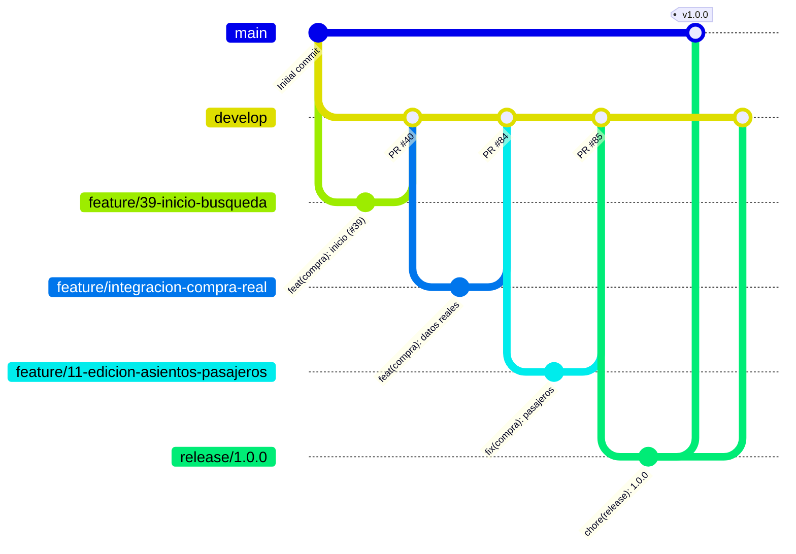

# Cómo contribuir a Gran Continental

Este archivo dice quién trabaja en el proyecto, qué hizo cada integrante y cómo entra un cambio al repositorio con Git Flow. Las reglas de aquí también se cambian por PR.

El docente audita los cambios de cada mes. Por eso cada cambio tiene un issue, una rama con el número de ese issue, commits que lo citan y un PR con la evidencia de las pruebas.

## Integrantes

| Integrante | GitHub | Módulo | Vistas del documento maestro V3 |
|---|---|---|---|
| Ángel Giovanni Galarza Moreta | `Aenkhell007` | Reservas, pagos, comprobantes, boleto y reembolso. Coordinador y dueño del repositorio | 6, 7, 7.1, 8, 9.2, 19.1, 19.1.1 |
| Kevin David Balseca Tumbaco (KT) | `Balseca-Kevin` | Compra del cliente: inicio, búsqueda, pasajeros, resumen y Mis viajes | 1, 1.1, 2, 4, 5, 9, 9.1 |
| Mikel Alejandro Guzmán Lescano | `Mikel032005AGL` | Flota, planos y mapa de asientos | 3.1, 3.2, 11.4, 16, 16.1, 19 |
| Matías Xavier Mena Romero | `matixavier1234-oss` | Identidad, registro, sesión, usuarios, roles y esquema de la base | 0.1, 0.2, 0.3, 10, 11.2, 20, 20.1, 20.2 |
| Patricio Benjamín Basurto Villalba | `99benjaminb` | Frecuencias, rutas, paradas, tarifas, beneficios, hoja de ruta y reportes | 11.1, 15, 17, 18, 19.2 |
| Pablo David Yupa Aguiar | `PABLOYUPA` | Oficina: venta presencial, revisión de comprobantes y reembolsos; panel de administración | 11, 12.x, 13, 14 |

Revisión cruzada: Benjamín revisa los PR de KT y KT revisa los de Benjamín. Los demás pares los asigna el coordinador en cada PR.

## Aportes por integrante

Cifras al 10/11/2026, `develop` en `3c5121b` (último merge, PR #117). Los PR son los fusionados con base `develop` según GitHub (65 en total), agrupados por autor. Los commits no cuentan merges (`git shortlog -sn --no-merges origin/develop`, 300 en total).

| Integrante | PR fusionados | Commits | Merges hechos con el botón de GitHub |
|---|---|---|---|
| Mikel | 18 | 86 | 11 |
| Ángel | 15 | 37 | 32 |
| Kevin | 11 | 60 | 9 |
| Matías | 11 | 71 | 4 |
| Benjamín | 6 | 36 | 1 |
| Pablo | 4 | 10 | 7 |

Un merge más no tiene autor registrado en GitHub.

### Ángel Galarza

PR #12 contratos de reservas, pagos y boletos; #16 layout compartido y conexión a Supabase; #25 método de pago; #32 subida de comprobante; #56 integración de identidad con Brevo; #69 seguimiento del pago (vista 7.1); #70 confirmación de compra (vista 8); #71 solicitud de reembolso (vista 9.2); #84 compra, reserva y pagos con PostgreSQL; #85 edición de asientos sin perder pasajeros; #102 layout del panel de administración; #103 layout del panel del oficinista; #104 configuración de pagos en el panel de cooperativa (vistas 19.1 y 19.1.1); #107 cabecera fija y lateral del panel; #117 conexión de las vistas de administración y oficina a sus menús.

Documentación: `docs/angel/`, `docs/integracion-pagos-reales.md`, `docs/integracion-compra-real.md`, `docs/edicion-asientos-pasajeros.md`.

### Kevin Balseca (KT)

PR #38 contrato de API de compra; #40 inicio y búsqueda; #42 resultados con filtros, orden y paginación; #51 datos de pasajeros por asiento; #53 resumen del viaje y descuentos; #55 Mis viajes e historial; #77 contrato de compra 0.3.0; #79 enlaces de Mis viajes a las vistas de pago; #81 reserva compartida entre la selección de asientos y los pasajeros; #83 fotos de buses; #112 ajustes de las vistas 1, 2, 4 y 5 (#88 a #93), imágenes del inicio en WebP, formato de Mis viajes y documentación raíz.

Documentación: `docs/kt/README.md`, `docs/api/compra-endpoints.md`.

### Mikel Guzmán

PR #2 propuesta de modelo de flota y asientos; #6 y #18 mapa de asientos con datos simulados; #10 y #17 contrato de API de flota; #15 esquema Prisma de flota; #20 mapa de asientos en el frontend; #24 CRUD de buses; #31 editor de plano; #34 cliente HTTP y servicio del mapa; #45 servicios de buses, planos y disponibilidad; #47 selección de asientos (vistas 3.1 y 3.2); #50 alineación del contrato de flota; #58 versiones de plano; #62 README del módulo (EC-004); #64 edición de bus; #67 indisponibilidades; #78 estilo del módulo.

Documentación: `docs/flota/`, `docs/api/flota-endpoints.md`, `docs/api/mapa-asientos.md`.

### Matías Mena

PR #5 esquema Prisma y estructura inicial del backend; #13 vistas de autenticación; #21 base de datos y vistas 10 y 0.3; #22 vistas de administración de identidad; #29 autenticación con JWT en el backend; #35 administración de identidad en el backend; #48 vistas de identidad y perfil; #65 administración de usuarios y cooperativas; #68 validaciones de gestión de cooperativas; #72 conexión de gestión de buses con la API; #98 modal y matriz de permisos de usuarios. Responsable de EC-REQ-01 y EC-DB-01 en el inventario.

### Benjamín Basurto

PR #26 estructura de frecuencias ANT; #27 paradas y tarifas por tramo (ADM06); #73 reglas de la hoja de ruta (vista 18); #99 listado, búsqueda y filtros de frecuencias; #100 interfaz de la hoja de ruta; #101 mejoras de paradas y tarifas.

Documentación: `docs/benjamin/planificacion-alcance.md`, `docs/benjamin/planificacion-pruebas.md`, `docs/benjamin/adm06-validaciones.md`.

### Pablo Yupa

PR #8 panel preliminar del oficinista; #60 tipos de la vista 11; #87 servicio de API de la vista 11; #106 resumen del panel de administración (vista 11). Archivos: `frontend/src/pages/oficina/BandejaComprobantes.tsx`, `frontend/src/pages/oficina/VentaPresencial.tsx`, `frontend/src/features/administracion/`.

## Modelo de ramas: Git Flow

| Rama | Sale de | Vuelve a | Regla |
|---|---|---|---|
| `main` | | | Solo versiones publicadas, cada una con etiqueta `vX.Y.Z`. Nadie hace push directo. |
| `develop` | `main` | `main` por `release/*` | Integración del trabajo terminado. Nadie hace push directo. |
| `feature/<issue>-<descripcion>` | `develop` | `develop` | Una funcionalidad o una vista por rama. La crea el dueño del módulo. |
| `release/<X.Y.Z>` | `develop` | `main` y `develop` | Solo versión, documentación y correcciones. La crea el coordinador. |
| `hotfix/<X.Y.Z>` | `main` | `main` y `develop` | Error en una versión publicada. Se avisa al coordinador. |



`release/1.0.0` y `v1.0.0` todavía no existen; el diagrama muestra cómo se publicará la primera versión.

El número de la rama es el del issue en GitHub y la descripción va en minúsculas con guiones: `feature/46-seleccion-asientos`. Un número de issue por rama: el número 11 se usó en 8 ramas (`feature/11-metodo-pago`, `feature/11-edicion-asientos-pasajeros` y seis más) y desde ahora no se repite. Al 10/11/2026 (`develop` en `3c5121b`) hay 26 ramas `feature/` sin número de issue (por ejemplo `feature/admin-usuarios` y `feature/integracion-compra-real`); quedan como están y las nuevas llevan número.

Las ramas no se borran, ni las locales ni las remotas, aunque ya estén integradas. Es una regla del docente: el historial completo de ramas es parte de la evaluación. `develop` y `main` además tienen bloqueado el borrado en GitHub.

Una rama puede salir de otra rama de feature cuando depende de un PR sin integrar. Su PR apunta a esa rama y, cuando la primera entra en `develop`, se cambia la base del PR a `develop`. Fue el caso de #85, que salió de #84.

## Trabajo diario

1. Crear el issue con la plantilla `.github/ISSUE_TEMPLATE/tarea.md` y anotar su número.
2. Crear la rama desde `develop` actualizado:

   ```sh
   git switch develop
   git pull origin develop
   git switch -c feature/90-descripcion-corta
   ```

3. Commits pequeños, uno por paso (tipos, servicio, componente, página, ruta, estilos).
4. Antes de abrir el PR, traer lo nuevo de `develop` sin reescribir commits publicados:

   ```sh
   git fetch origin
   git merge origin/develop
   npm --prefix frontend run build
   npm --prefix backend run check:api
   git push -u origin feature/90-descripcion-corta
   ```

5. Abrir el PR hacia `develop` con la plantilla. El merge lo hace el coordinador después de las aprobaciones.

Después de cada merge en `develop`, cada integrante actualiza su copia (`git switch develop`, `git pull`) y lleva los cambios a su rama con `git merge develop`. Antes de cambiar de rama se revisa `git status`; los cambios sin guardar se confirman o se guardan con `git stash`.

### Conflictos

Antes del commit que resuelve un conflicto:

```sh
git diff --check
git grep -n -e '<<<<<<<' -e '>>>>>>>'
```

En `feature/68-integracion-api-buses` quedaron marcadores en `BusesPage.tsx` y hicieron falta tres commits de corrección (`b8aa433`, `bb71085`, `8a4835b`) antes del merge de #72.

### Fines de línea

El repositorio guarda los archivos de texto con LF; `.gitattributes` lo fija con `* text=auto eol=lf`. Un editor en Windows que guarda con CRLF hacía que Git marcara el archivo entero como modificado sin cambio real. Para comprobarlo: si `git diff --ignore-cr-at-eol --stat` sale vacío, el cambio es solo de fin de línea y se descarta con `git restore <archivo>`. En cada copia local conviene `git config core.autocrlf input`.

## Commits

Conventional Commits, en español, en minúsculas y con el número del issue al final:

```text
<tipo>(<ámbito>): <descripción en imperativo> (#<issue>)
```

Tipos: `feat`, `fix`, `docs`, `style`, `refactor`, `test`, `build`, `chore`, `db`. Ámbitos más usados en el historial de `develop` (cifras al 10/11/2026, `develop` en `3c5121b`): `flota` (65 commits), `compra` (51), `frontend` (44), `api` (28), `backend` (19), `paradas` (18), `frecuencias` (11), `admin` (11), y `pagos`, `identidad`, `operacion` e `historial` (7 cada uno). También se usan `oficina`, `paneles`, `configuracion`, `prisma`, `auth` y `database`.

Ejemplos del historial: `feat(compra): crear la reserva con los asientos elegidos y conservarla al recargar (#80)`, `fix(flota): eliminar marcadores de conflicto de Git y limpiar bloque repetido`.

Un commit no mezcla dos módulos. `package-lock.json` solo cambia cuando el PR agrega o actualiza una dependencia.

## Pull requests

1. Base `develop`, salvo una rama que depende de otro PR abierto.
2. Título con el formato de commit.
3. Descripción con la plantilla `.github/pull_request_template.md`: cambio, issue (`Closes #90`), tipo de cambio, archivos, pruebas, pendientes y verificaciones del autor.
4. Dos aprobaciones de integrantes distintos al autor. Quien encuentra un problema pide cambios citando la línea y el error.
5. Merge con el botón de GitHub (merge commit). No se usa squash ni rebase sobre `develop`.
6. La rama se conserva después del merge.

Las pruebas se informan en tres partes:

- Pruebas unitarias: comando y número de pruebas aprobadas.
- Prueba de integración contra la base (`test:pagos:db`), si aplica.
- Recorrido manual: rutas, anchos de pantalla y resultado.

En un PR no van URL con contraseña, tokens de sesión o de activación, contenido de archivos `.env`, cédulas o teléfonos reales, ni capturas donde se vean.

Imágenes nuevas en WebP y con menos de 500 KB cada una.

## Control de cambios después de la versión 1.0.0

Cuando `v1.0.0` esté en `main`, un cambio a una vista ya integrada necesita una solicitud de cambio (SCR) aprobada por el comité de cambios antes de escribir código. El PR cita el issue y el SCR.

| Tipo de cambio | Cuándo | Aprobación |
|---|---|---|
| Estándar | Bajo riesgo y ya previsto: texto, estilo, documentación | Revisión normal del PR |
| Normal | Funcionalidad nueva o cambio de comportamiento | Comité de cambios (CCB) |
| Corrección de defecto | Error en algo ya integrado | Revisión normal; `hotfix/*` si ya está en `main` |

## Base de datos compartida

- Todos usan la misma base en Supabase. Lo que guarda un integrante lo ven los demás.
- Las migraciones las aplica solo el encargado con `db:deploy`. No se usa `migrate reset` ni `db push`, y no se repite el baseline.
- Una migración publicada no se edita. Un cambio de esquema es una migración nueva con nombre `AAAAMMDD_descripcion`.
- No se cambian estados de reservas o pagos con SQL directo, ni se desactivan RLS o triggers.
- Los datos de prueba (viajes, cédulas de prueba) no se duplican; si faltan, se avisa al encargado.

## Credenciales

Los valores de `DATABASE_URL`, `DIRECT_URL`, `BREVO_API_KEY` y el certificado se entregan fuera de GitHub. Si una credencial llega a un commit, aunque sea en una rama, se avisa al coordinador para cambiarla en Supabase o en Brevo. Borrar el archivo en otro commit no la quita del historial.

## Versiones

Versionado semántico `MAYOR.MENOR.PARCHE`. La primera parte del proyecto se publica como `1.0.0`.

```sh
git switch develop && git pull
git switch -c release/1.0.0
# actualizar "version" en los package.json y la fecha de README.md
git commit -am "chore(release): 1.0.0"
git push -u origin release/1.0.0
# PR release/1.0.0 -> main. Después del merge:
git switch main && git pull
git tag -a v1.0.0 -m "Primera parte: compra, pagos, flota, identidad y operación"
git push origin v1.0.0
# PR release/1.0.0 -> develop para devolver los cambios de la release
```

Un hotfix sigue el mismo camino desde `main` con `hotfix/1.0.1`.

## Protección de ramas

`develop` y `main` comparten el conjunto de reglas 25032201 de GitHub (`gh api repos/Aenkhell007/ProyectoTransporteBuses/rules/branches/develop`, consultado el 10/11/2026):

- Pull request obligatorio con 2 aprobaciones.
- Las aprobaciones se descartan cuando llega un commit nuevo, y el último push necesita una aprobación de otra persona.
- Las conversaciones del PR tienen que estar resueltas.
- No se permite borrar la rama ni hacer force push.

GitHub permite merge, squash y rebase; el equipo usa solo merge commit.

## Elementos de configuración

El inventario está en `docs/configuracion/inventario-ec.csv`, con las columnas ID, Nombre, Tipo, Responsable, Versión y Estado. Cada módulo registra ahí su elemento y lo cita en su README. Un cambio de versión o de estado del elemento entra en el mismo PR que lo causa. Los ID nuevos los asigna el coordinador; no se deducen de EC-004 ni de EC-007.
